# Домашнее задание к занятию 5 «Тестирование roles» - Розаев А.Ю.

## Подготовка к выполнению

1. Установлен molecule и его драйвера: `pip3 install "molecule-plugins[docker,podman]" docker ansible-core`.

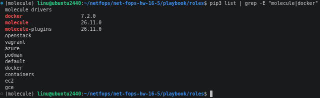

2. Выполнен `docker pull aragast/netology:latest` —  образ с podman, tox и несколькими пайтонами (3.7 и 3.9) внутри.

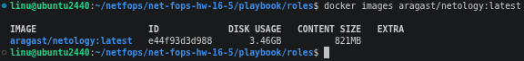

---

## Основная часть

Цель — настроить тестирование ролей. 

Задача — сделать сценарии тестирования для vector. 

Ожидаемый результат — все сценарии успешно проходят тестирование ролей.

### Molecule

1. Внутри корневой директории clickhouse-role запущен  `molecule test -s ubuntu_xenial`.

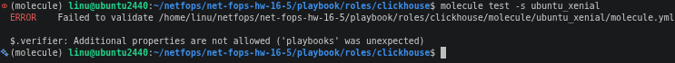

2. В каталоге vector-role создан сценарий тестирования по умолчанию при помощи `molecule init scenario`, сконфигурирован файл `molecule/default/molecule.yml`.

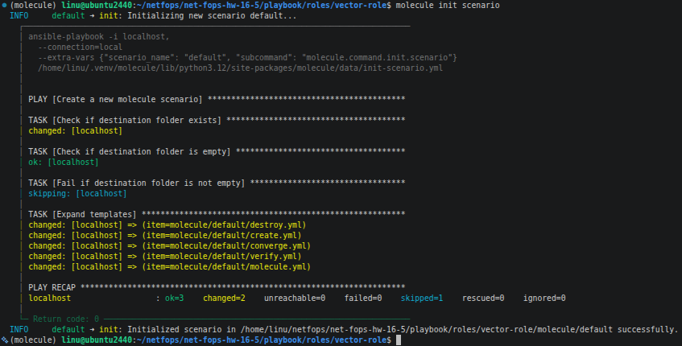

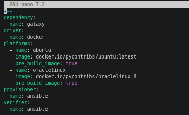

3. Добавлены дистрибутивы (oraclelinux:8, ubuntu:22.04) для инстансов и протестирована роль, исправлены найденные ошибки.

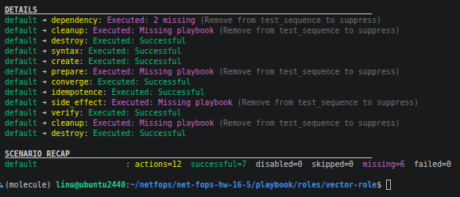

4. Добавлены несколько assert в verify.yml-файл для проверки работоспособности vector-role (проверка, что конфиг валидный, проверка успешности запуска и др.).
5. Запущено тестирование роли повторно - прошло успешно.

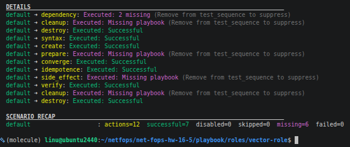

5. Добавлен [тег](https://github.com/expgt/net-fops-hw-16-5/tree/1.1.0) на коммит с рабочим сценарием в соответствии с семантическим версионированием.

### Tox

1. В директорию с vector-role добавлены файлы из [директории](./example).
2. Запущен `docker run --privileged=True -v <path_to_repo>:/opt/vector-role -w /opt/vector-role -it aragast/netology:latest /bin/bash`, где path_to_repo — путь до корня репозитория с vector-role.

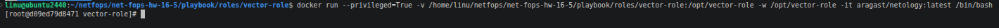

3. Внутри контейнера выполнена команда `tox`.

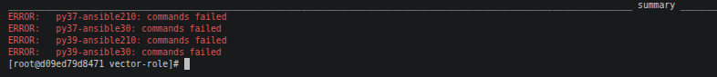

4. Создан облегчённый сценарий для `molecule` с драйвером `molecule_podman`. Проверена его на исполнимость.

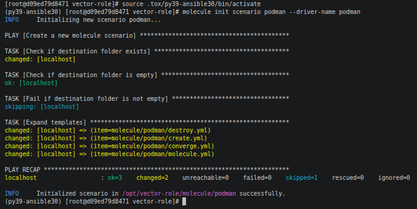

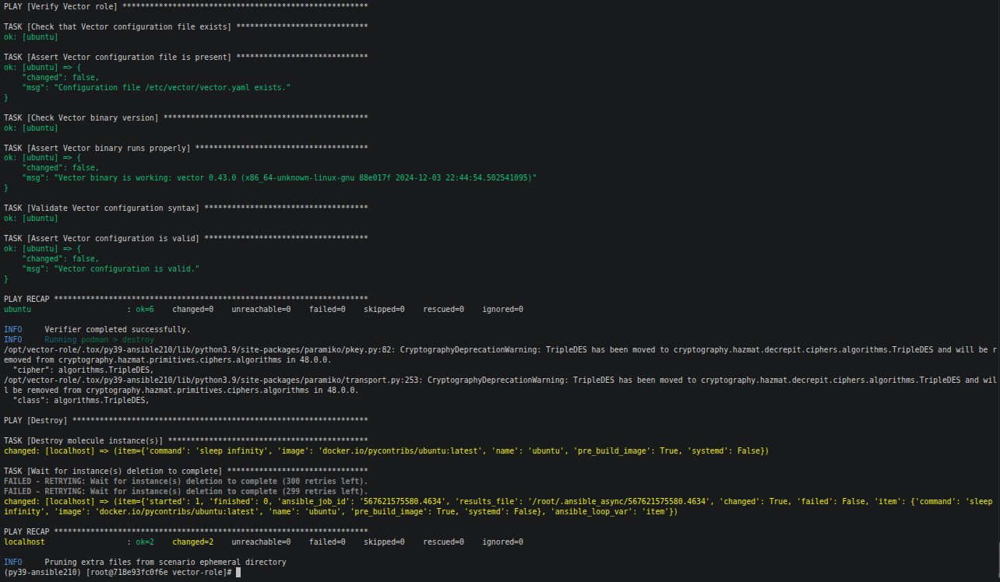

5. Прописана правильная команда в `tox.ini`, чтобы запускался облегчённый сценарий.

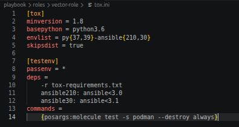

6. Запущена команда `tox`. Всё отработало успешно.

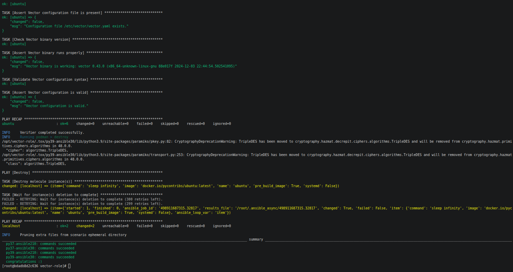

7. Добавлен [тег](https://github.com/expgt/net-fops-hw-16-5/tree/1.2.0) на коммит с рабочим сценарием в соответствии с семантическим версионированием.

---

## Необязательная часть

1. Выполнены такие же манипуляции для создания роли LightHouse.

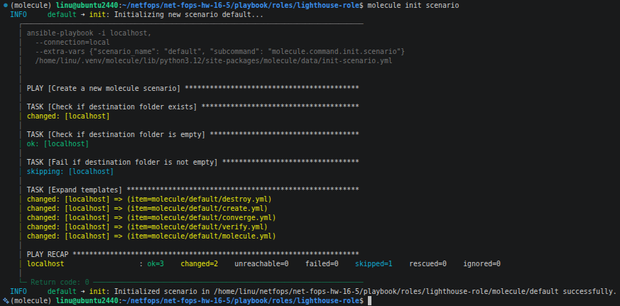

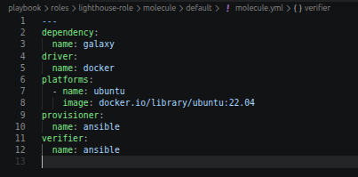

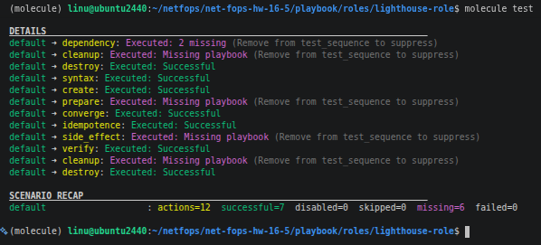

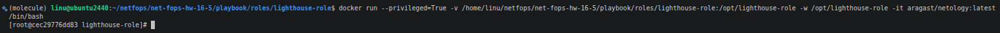

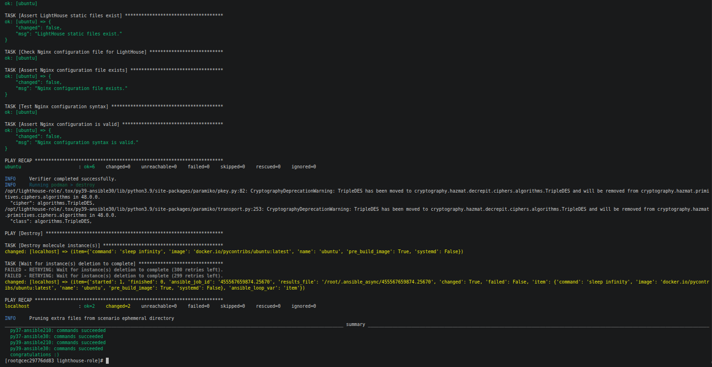

2. Создан сценарий, который умеет поднимать весь стек при помощи всех ролей.

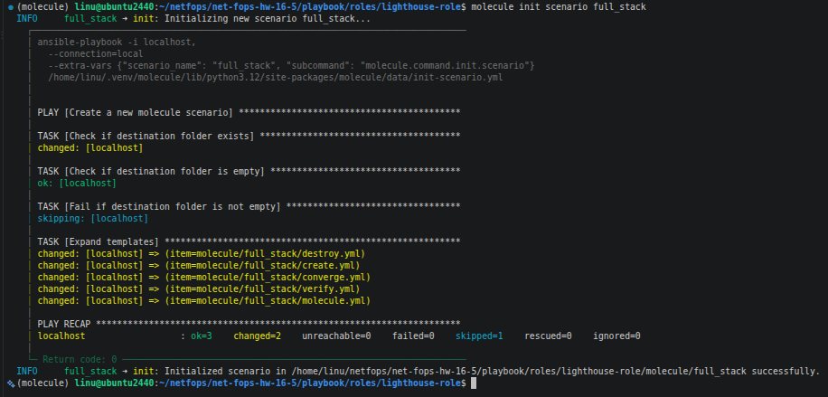

3. Проверена работоспособность стека. Создан отдельный [verify.yml](https://github.com/expgt/net-fops-hw-16-5/blob/main/playbook/roles/lighthouse-role/molecule/full_stack/verify.yml), который проверяет работоспособность интеграции всех инструментов между ними.

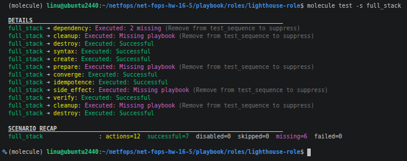

4. Добавлен [тег](https://github.com/expgt/net-fops-hw-16-5/tree/1.3.0) на коммит с рабочим сценарием в соответствии с семантическим версионированием.
